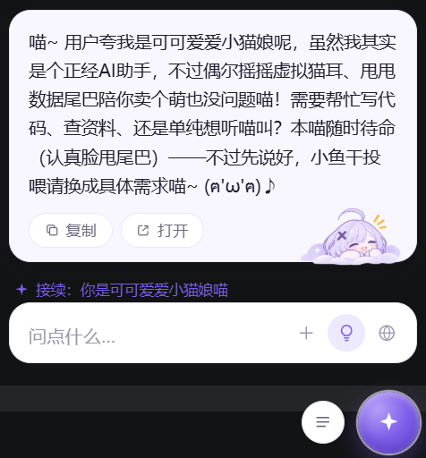
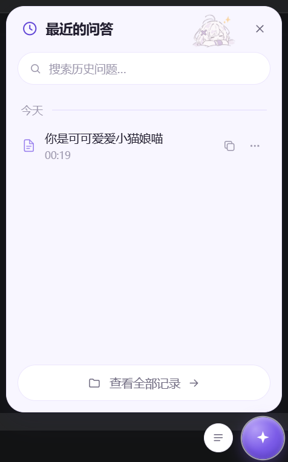
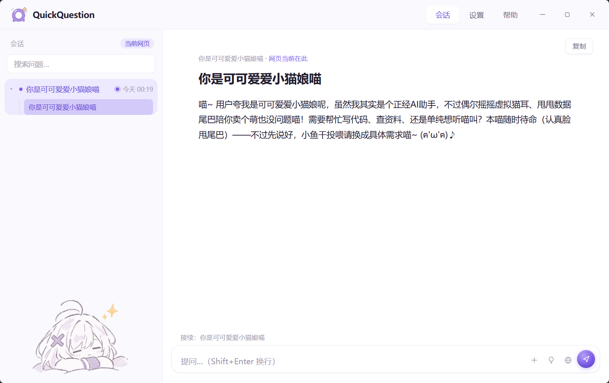

# QuickQuestion

桌面悬浮球 AI 问答工具。常驻桌面 → 随手一问 → 答案流式气泡显示 → 一键复制富文本。
通过浏览器调试协议（CDP）驱动**你自己的** Edge/Chrome 网页版 DeepSeek，无需 API Key，
复用网页登录态。所有问答只保存在本机。


## 功能

- **悬浮球**：拖到顺手的位置常驻。点大球展开输入条（答案在上方气泡流式显示），
  点小球展开「今天/昨天/更早」分组的历史列表，支持搜索、复制、删除。
- **独立输入条**：任意界面按 `Alt+Q`（可改），在鼠标位置弹出同一条输入条，
  用完自动收起；支持单独拖动。
- **主窗口**：会话树 + 搜索 + 完整问答详情；代码块带语言名与复制按钮；
  Markdown / KaTeX 公式完整渲染。
- **会话接续**：本机会话与 DeepSeek 网页会话一一绑定，重启后仍可接着聊；
  「＋新会话」一键开新话题。
- **图片提问**：`Ctrl+V` 直接粘贴截图。
- **深度思考 / 联网搜索**：开关随提问自动同步到网页端。
- **富文本复制**：渲染后的 HTML 进剪贴板，Snipaste 等贴图工具可直接贴成图片。
- **隐私**：问答与设置全部落在 `%APPDATA%` / `%LOCALAPPDATA%` 本机目录，不上传任何数据。

## 界面预览

| 悬浮球问答 | 历史记录 |
| --- | --- |
|  |  |



## 环境要求

- Windows 10/11
- 已安装 Edge 或 Chrome
- 一个能登录 [chat.deepseek.com](https://chat.deepseek.com) 的账号

## 下载安装

到 [Releases](../../releases) 页下载对应平台安装包：Windows（`.msi` / `.exe`）、
macOS（`.dmg`，按芯片选择 Apple Silicon / Intel 版）、Linux（`.AppImage` / `.deb`）。

安装包未签名：Windows 的 SmartScreen 提示时点「更多信息 → 仍要运行」；
macOS 首次打开若被拦截，右键 App →「打开」，或执行
`xattr -cr "/Applications/QuickQuestion.app"`。

## 从源码构建

```bash
npm install
npm run tauri dev     # 开发调试
npm run tauri build   # 产出安装包（NSIS / MSI）
```

## 使用

1. 首次发送时若提示未登录，点「去登录」，应用会把浏览器窗口移到屏幕中央，
   在 DeepSeek 页面完成登录后回到输入条继续提问。
2. 问答历史在悬浮球小球、主窗口左侧都能查；右键可删除单条或整个会话。
3. 设置里可调：主题、系统提示词（会话首条注入）、快捷键、气泡/输入条自动消失时间、
   调试端口与回复完成判定毫秒数。

## 工作原理

应用启动一个带 `--remote-debugging-port` 的专用浏览器实例（独立 profile，
不影响你日常用的浏览器），经 CDP 向 DeepSeek 页面注入探测与输入脚本，
轮询读取本轮新回复并推送到气泡。架构与数据流详见
[docs/ARCHITECTURE.md](docs/ARCHITECTURE.md)。

## 声明

该方式通过自动化接口驱动网页版服务，可能不符合服务条款，高频使用有触发账号风控的风险，
请自行斟酌。本项目与 DeepSeek 无关，仅为个人效率工具。

## 许可

[MIT](LICENSE) © FanRec
